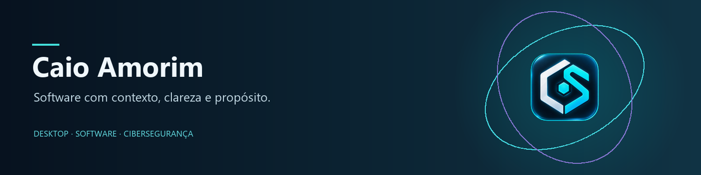

# Olá! Sou o Caio Amorim.

Programador em formação, com interesse em **desenvolvimento de software, aplicações desktop, cibersegurança e inteligência artificial**.

Gosto de compreender como as peças se ligam: uma interface clara, um serviço que responde, dados preservados e resultados que se conseguem explicar.

## Projeto em destaque

### [CyberSafe Assistant](https://github.com/MatrixChill/cybersafe-assistant)

Aplicação Windows desenvolvida no âmbito da **Prova de Aptidão Profissional**, com integração de motores de análise e assistência **MATRIX**.

Scanner multimotor · monitorização · quarentena · diagnóstico local · interface Electron/React.

O projeto tem uma edição académica pública. Os limites de proteção, assinatura e atualização são documentados com os resultados dos ensaios.

[Ver o projeto](https://github.com/MatrixChill/cybersafe-assistant) · [Descarregar a versão Windows](https://github.com/MatrixChill/cybersafe-assistant/releases/latest) · [Ler a documentação](https://github.com/MatrixChill/cybersafe-assistant/blob/main/docs/README.md)

## Tecnologias que utilizo

## Em exploração

[**Linux Lite**](https://github.com/MatrixChill/cybersafe-assistant/tree/experimental/linux-lite) — ramo experimental do CyberSafe para Linux, com foco em compatibilidade e limites próprios. Não é apresentado como uma edição equivalente à versão Windows.

## Vamos conversar

Encontra os meus projetos e atividade pública aqui no [GitHub](https://github.com/MatrixChill).
